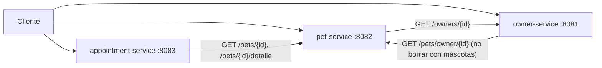

# Clínica Veterinaria – Microservicios (Java 21 + Spring Boot 3)

Tres microservicios REST, cada uno con su propia base de datos MySQL, desplegados con Docker Compose.

| Servicio | Puerto | Base de datos | Qué hace |
|---|---|---|---|
| `owner-service` | 8081 | `owners_db` | Propietarios |
| `pet-service` | 8082 | `pets_db` | Mascotas |
| `appointment-service` | 8083 | `appointments_db` | Citas |



## Cómo ejecutarlo

**Con Docker** (en tu PC o en GitHub Codespaces):
```bash
docker compose up --build
```
Cuando arranquen, abre el Swagger de cada servicio (añade `/swagger-ui.html`):
`localhost:8081`, `localhost:8082` y `localhost:8083`.
Para detener: `docker compose down`.

**Pruebas automáticas** (requiere Java 21 y Maven; no necesita Docker ni MySQL):
```bash
cd owner-service && mvn test
cd ../pet-service && mvn test
cd ../appointment-service && mvn test
```

**Postman:** importar `postman/Clinica_Veterinaria.postman_collection.json` y usar *Run collection*.

## Qué hay en cada servicio

Cada servicio tiene el mismo esquema de archivos (carpeta `src/main/java/com/clinica/<servicio>/`), todos comentados:

| Archivo | Para qué sirve |
|---|---|
| `...Application.java` | Arranca el servicio y configura el `RestTemplate` (llamadas HTTP a otros servicios). |
| `Owner.java` / `Pet.java` / `Appointment.java` | Entidad (tabla de la base de datos). Incluye los enumerados. |
| `...Repository.java` | Acceso a la base de datos (Spring Data genera el SQL). |
| `Dtos.java` | Formatos JSON de entrada/salida y sus validaciones. |
| `Errores.java` | Excepciones de negocio y su traducción a códigos HTTP. |
| `PetClient.java` / `OwnerClient.java` | Cliente HTTP hacia otro microservicio. |
| `...Service.java` | **Reglas de negocio.** Es el archivo más importante. |
| `...Controller.java` | Endpoints REST. |
| `src/main/resources/application.yml` | Configuración (puerto, base de datos, URLs de otros servicios). |
| `src/test/.../...ServiceTest.java` | Pruebas unitarias (Mockito). |
| `src/test/.../...ApiTest.java` | Pruebas de integración (MockMvc + H2). |

## Endpoints

- **Owner (8081):** `GET/POST /owners`, `GET/PUT/DELETE /owners/{id}`
- **Pet (8082):** `GET/POST /pets`, `GET/PUT/DELETE /pets/{id}`, `GET /pets/owner/{ownerId}`, `GET /pets/{id}/detalle`
- **Appointment (8083):** `GET/POST /appointments`, `GET/PUT/DELETE /appointments/{id}`, `GET /appointments/pet/{petId}`, `GET /appointments/{id}/completa`

## Reglas de negocio y códigos HTTP

| Servicio | Regla | HTTP |
|---|---|---|
| Owner | Documento o correo repetido | 409 |
| Owner | Teléfono obligatorio | 400 |
| Owner | No eliminar si tiene mascotas | 409 |
| Pet | Propietario inexistente | 400 |
| Pet | Sin nombre / fecha de nacimiento futura | 400 |
| Appointment | Mascota inexistente | 404 |
| Appointment | Fecha u hora pasada | 400 |
| Appointment | Misma fecha y hora que otra cita no cancelada | 409 |
| Appointment | Modificar o eliminar cita atendida | 409 |
| Cualquiera | Otro servicio caído o con timeout | 503 |

Los errores siempre tienen la forma `{timestamp, status, error, mensaje, ruta}`.

## Decisiones de diseño

- No hay claves foráneas entre servicios: `Pet.ownerId` y `Appointment.petId` son referencias lógicas validadas por REST.
- Una cita cancelada libera su horario. Toda cita nueva queda `PROGRAMADA`.
- Los estados se escriben en mayúsculas: `ACTIVO`, `EN_TRATAMIENTO`, `RECUPERADO`, `FALLECIDO` / `PROGRAMADA`, `CONFIRMADA`, `ATENDIDA`, `CANCELADA`.
- Variables de entorno opcionales: `DB_URL`, `DB_USER`, `DB_PASSWORD`, `PET_SERVICE_URL`, `OWNER_SERVICE_URL`, `CLIENT_CONNECT_TIMEOUT_MS`, `CLIENT_READ_TIMEOUT_MS`.
